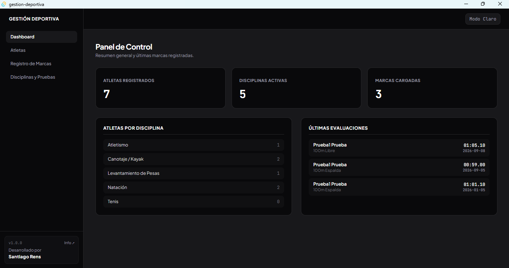
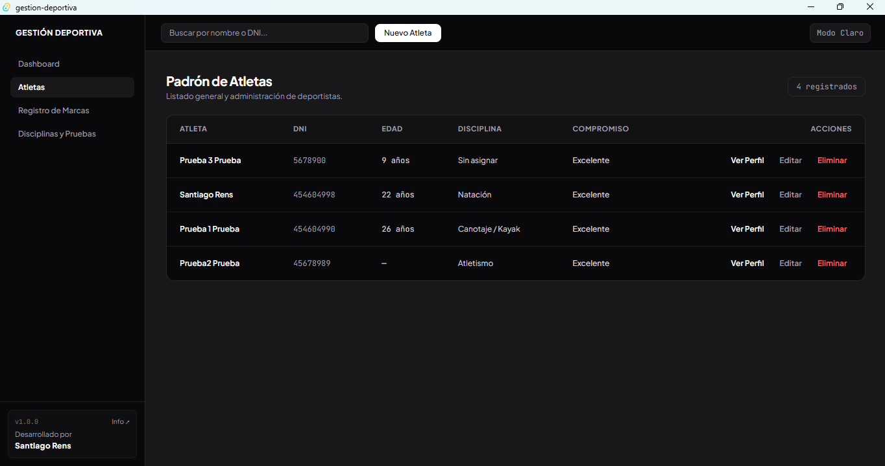
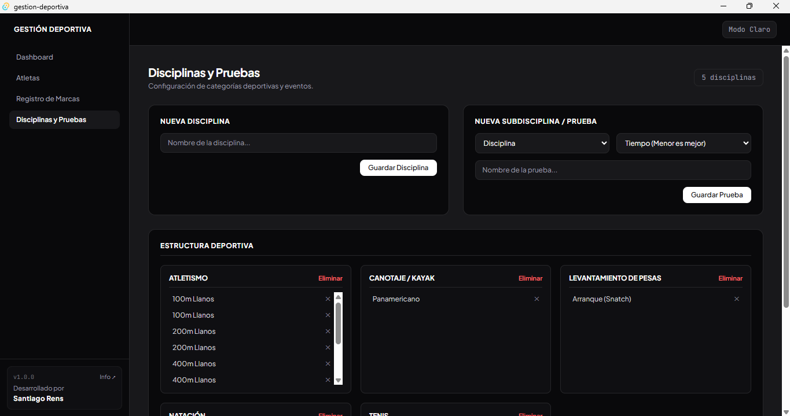
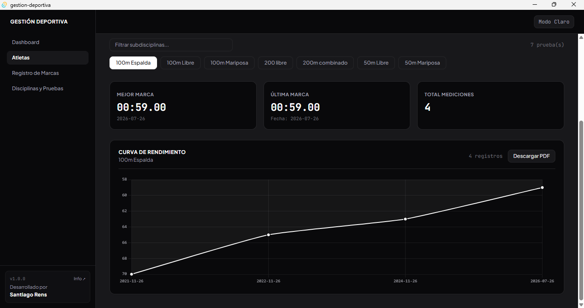

# Gestión Deportiva — Software de Alto Rendimiento

[](https://tauri.app/)
[](https://vuejs.org/)
[](https://www.sqlite.org/)
[](https://tailwindcss.com/)

Aplicación de escritorio multiplataforma desarrollada para la administración centralizada de atletas, catalogación de disciplinas y pruebas deportivas, y el seguimiento técnico del rendimiento mediante métricas cronológicas, visualizaciones gráficas y reportes de desempeño en formato PDF.

---

## 🛠️ Stack Tecnológico y Arquitectura

El sistema está construido bajo una arquitectura de escritorio moderna, segura y ligera, separando la interfaz de usuario de la lógica nativa y la persistencia relacional:

* **Framework Desktop:** [Tauri](https://tauri.app/) (Core en Rust para interacción nativa con el sistema operativo).
* **Frontend Web:** [Vue 3](https://vuejs.org/) (Composition API) con [Tailwind CSS](https://tailwindcss.com/).
* **Base de Datos:** [SQLite](https://www.sqlite.org/) embebida localmente mediante `@tauri-apps/plugin-sql`.
* **Visualización de Datos:** [Chart.js](https://www.chartjs.org/) para curvas evolutivas de rendimiento.
* **Generación de Reportes:** [jsPDF](https://github.com/parallax/jsPDF) integrado con diálogos nativos del sistema operativo (`@tauri-apps/plugin-dialog` y `@tauri-apps/plugin-fs`).

---

## 🚀 Características Principales

* **Gestión Integral de Atletas (CRUD):** Alta, modificación, consulta y filtrado de deportistas con ficha filiatoria completa, nivel de compromiso y observaciones.
* **Catálogo de Disciplinas y Pruebas:** Parametrización de deportes (Natación, Atletismo, Kayak) y pruebas específicas con métricas adaptativas (tiempo, distancia, peso).
* **Registro de Marcas y Evaluaciones:** Carga cronológica de resultados técnicos con cálculo de mejor marca según la polaridad de la métrica.
* **Dashboard y Curvas Evolutivas:** Gráficos dinámicos de rendimiento y estadísticas acumuladas por atleta y disciplina.
* **Exportación de Informes PDF:** Generación de fichas técnicas individuales con guardado directo mediante la ventana nativa "Guardar como..." de Windows.
* **Empaquetado Autónomo:** Distribución mediante instalador `.exe` (NSIS) ejecutable de forma totalmente local y sin dependencias de servidor externo.

---

## 📸 Capturas del Sistema

### Dashboard Principal


### Padrón de Atletas


### Gestión de Disciplinas y Subdisciplinas


### Curvas Evolutivas y Gráficos de Rendimiento


---

## 📋 Requisitos del Entorno de Desarrollo

Para ejecutar o compilar el proyecto desde el código fuente se requiere:

* **Node.js:** `v18.x` o superior.
* **Package Manager:** `npm` o `pnpm`.
* **Rust toolchain:** `rustc` y `cargo` (requerido por Tauri).
* **Entorno de Compilación en Windows:** C++ Build Tools (VS Community o Microsoft C++ Build Tools).

---

## 🔧 Instalación y Ejecución Local

1. **Clonar el repositorio:**
   ```bash
   git clone https://github.com/santiagorens29-boop/gestion-deportiva.git
   cd gestion-deportiva
   ```

2. **Instalar dependencias del frontend:**
   ```bash
   npm install
   ```

3. **Ejecutar la aplicación en modo desarrollo:**
   ```bash
   npm run tauri dev
   ```

---

## 📦 Compilación y Generación del Ejecutable (.exe)

```bash
npm run tauri build
```

* El instalador ejecutable `.exe` se generará automáticamente en la ruta:
  `src-tauri/target/release/bundle/nsis/`

---

## 📂 Estructura del Proyecto

```text
├── src/
│   ├── components/      # Componentes de UI (Sidebar, Modales, Headers)
│   ├── views/           # Vistas principales (Dashboard, Atletas, Marcas, Disciplinas)
│   ├── composables/     # Lógica reutilizable de estado y consultas
│   ├── database/        # Configuración del esquema relacional SQLite (db.js)
│   └── utils/           # Módulos de exportación PDF y utilidades
├── src-tauri/
│   ├── src/             # Código fuente en Rust (main.rs, lib.rs)
│   ├── capabilities/    # Permisos de plugins nativos (dialog, fs, sql)
│   └── tauri.conf.json  # Configuración principal de empaquetado Tauri
├── docs/
│   ├── capturas/        # Capturas de pantalla del sistema
│   └── uml/             # Diagramas UML y documentación técnica académica
└── README.md
```

---

## 🎥 Demo y Documentación Académica

* **Demo Pre-grabada (Video):** [Ver demostración funcional del sistema](https://drive.google.com/file/d/1CuJSESZ_qIMZ25vF822nEwPyBqHpgphl/view?usp=sharing)
* **Institución:** Universidad de Belgrano
* **Carrera:** Tecnicatura en Programación / Ingeniería Informática
* **Materia:** Prácticas de Laboratorio
* **Autor / Desarrollador:** Santiago Rens (santiagorens29@gmail.com)