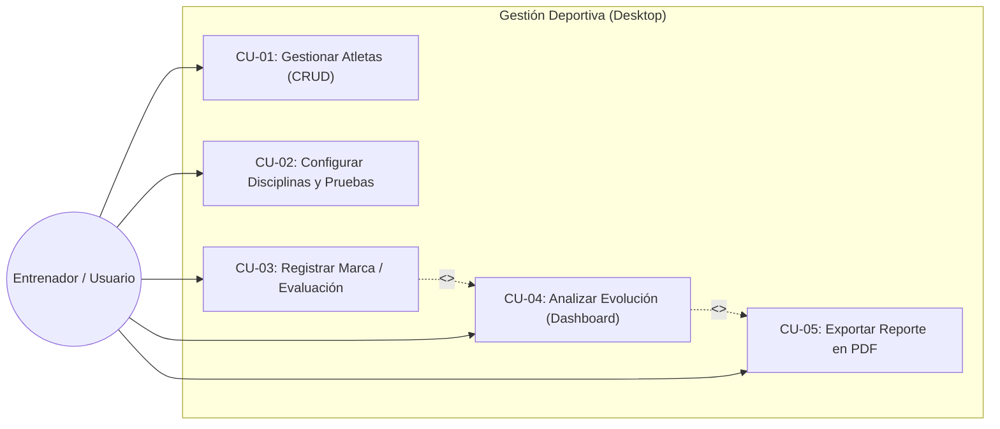
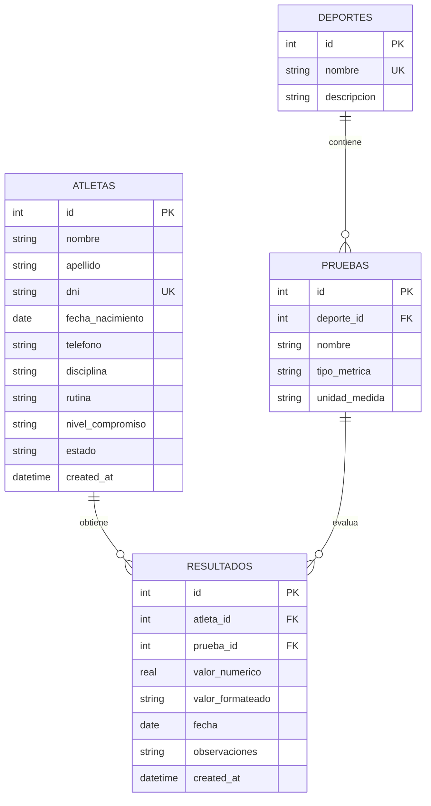

# Diagramas UML y Arquitectura del Sistema

A continuación se presentan los diagramas de modelado de software correspondientes a la aplicación de escritorio **Gestión Deportiva**.

---

## 1. Diagrama de Casos de Uso

Modela las interacciones principales del usuario (entrenador o preparador físico) con los módulos funcionales del sistema.

---

## 2. Diagrama Entidad-Relación (Modelo de Datos SQLite)

Estructura de la base de datos relacional local (`deportes.db`) con sus tablas, atributos, claves primarias (PK), foráneas (FK) y relaciones.

